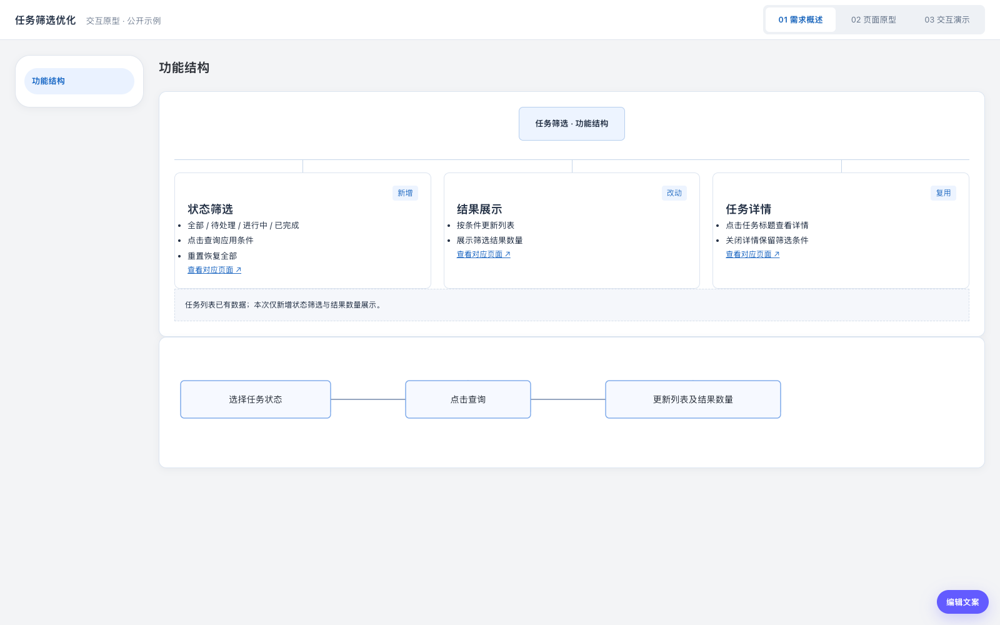
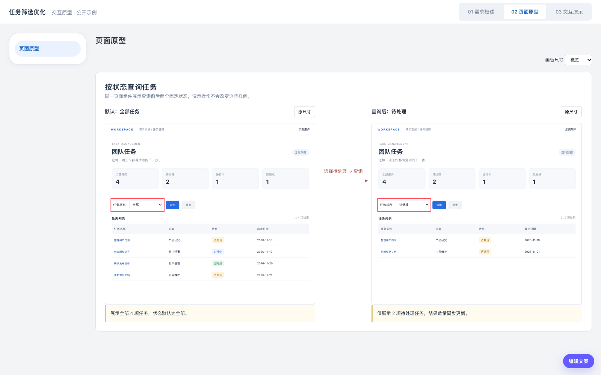
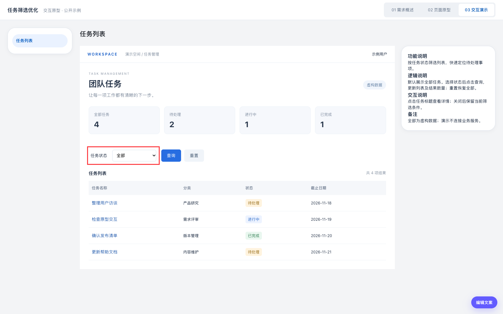
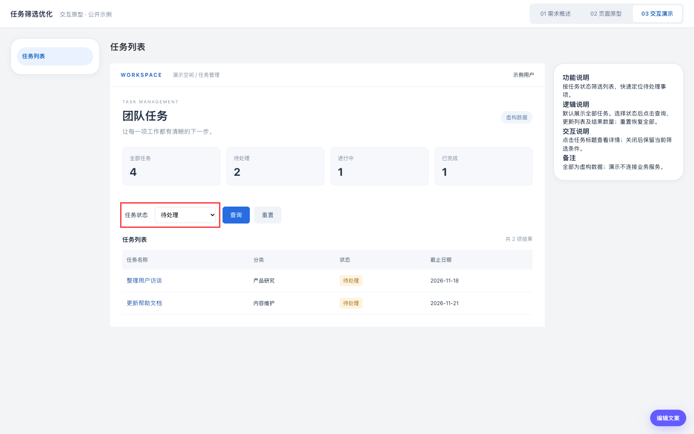

# 交互原型

把已有 PRD 和界面依据制作成单文件 HTML 评审原型：**需求概述、页面原型、交互演示**。包含静态画板、流程连线、文案编辑和离线评审版导出。

## 示例展示

以下截图来自仓库内可运行的[任务筛选示例](examples/task-filter.html)，全部使用虚构数据。下载 HTML 后用浏览器打开，可切换板块、筛选任务、查看详情、编辑文案和导出评审版；对应[示例 PRD](examples/PRD.md)一并提供。

### 需求概述：功能结构与变更范围



### 页面原型：固定画板与操作连线



### 交互演示：实际操作与页面说明



<details>
<summary>查看筛选后的实际结果</summary>



</details>

## 适用范围

需要能读取文件、执行 Node.js 命令并启动本机浏览器的 AI 编程助手。纯聊天环境无法完成本 Skill 的装配和验收。必须提供已有 PRD；已有产品的界面调整还应提供截图、源码或旧原型。输出用于需求评审，不能直接作为生产应用。

生成及验收需要 Node.js 22+、npm、Chrome/Chromium；Mermaid 转图另外使用 npm 安装的 Mermaid 和 playwright-core。首次安装依赖需要联网，之后生成的 HTML 不依赖 npm、服务器或远程图示库。阅读者只需浏览器。

## 安装

可以下载 ZIP，或克隆仓库：

```sh
git clone https://github.com/monsignorlaw1015/interactive-review-prototype.git
```

保留 SKILL.md、assets、scripts、references 的目录关系。将整个目录安装到宿主支持的 Skill 目录，例如：

| 宿主 | 用户级安装位置示例 |
| --- | --- |
| Claude Code | `~/.claude/skills/交互原型/` |
| Codex | `~/.agents/skills/交互原型/` |
| MyAgents | `~/.myagents/skills/交互原型/` |

安装目录以宿主配置为准；如不支持中文 Skill 标识，可将文件夹和 SKILL.md 的 `name` 同时改为 `interactive-review-prototype`。部分宿主不提供斜杠命令，可直接要求 AI 使用该目录下的 SKILL.md；宿主适配尚未逐一实测。

在安装目录执行（依赖安装不运行包脚本）：

```sh
npm ci --ignore-scripts
npm run check
```

环境检查会检查 Node、公开依赖，并真实启动无头浏览器。浏览器安装在非标准位置时，设置 `CHROME_PATH` 为可执行文件绝对路径。该设置统一用于转图及两类验收：

```sh
# macOS / Linux：路径替换为自己的浏览器位置
export CHROME_PATH="/absolute/path/to/chrome"
npm run check
```

```powershell
# Windows PowerShell
$env:CHROME_PATH = 'C:\Program Files\Google\Chrome\Application\chrome.exe'
npm run check
```

不自动下载浏览器。Linux 容器还需具备浏览器运行所需的系统库；检查失败会给出错误，不会跳过验收。

## 使用

在识别中文命令的宿主中调用 `/交互原型`，附上 PRD Markdown 及现状材料，例如：

> 使用交互原型 Skill，根据 PRD.md 和 screenshots 里的现状图，生成桌面端评审原型，输出到项目的 deliverables 目录。

AI 按 SKILL.md 读取参考、装配三板块、验证并检查导出。输出目录由使用者决定，仓库不要求个人工作区结构。

需要手动执行时，以下命令均可从任意工作目录调用。将 `<skill-dir>` 和其他路径替换成实际绝对路径：

```sh
node "<skill-dir>/scripts/check-env.mjs"
node "<skill-dir>/scripts/render-prd-mermaid.mjs" --prd "/path/PRD.md" --out "/path/diagrams"
node "<skill-dir>/scripts/assemble.mjs" "/path/prototype.html"
node "<skill-dir>/scripts/verify.mjs" "/path/prototype.html" "/path/PRD.md" "/path/evidence"
```

仅 PRD 含 Mermaid 时需要转图。`assets/example.html` 是组件示例，可先复制到自己的工作目录再装配与验证，避免修改安装包。

## 验证边界

自动检查覆盖编辑绑定、评审结构、图源关联和逐页截图，不能替代业务核对、截图目检与导出重开。缺执行权限、浏览器或业务依据时只能交付未完成草稿。

不同操作系统、宿主及复杂业务的完整生成效果仍需复验；提供跨平台路径支持不等于已通过各平台实机验收。`evals/evals.json` 是后续生成评估场景，不是已通过记录。

## 许可

本仓库原创代码及文档采用 MIT，见 LICENSE。npm 第三方依赖保留各自许可证。发布示例应使用虚构数据，用户提供的 PRD、截图和业务素材由其自行确认分享权限。
