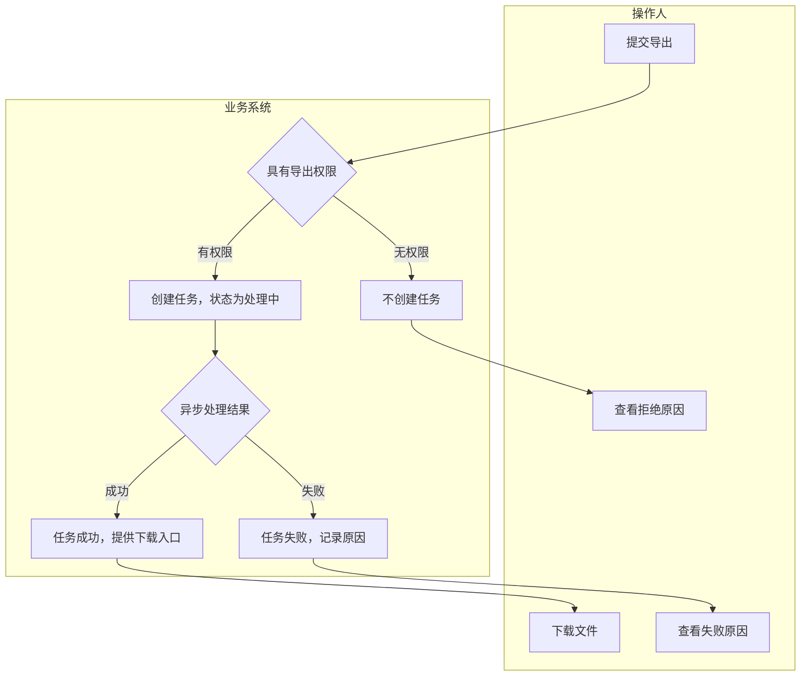
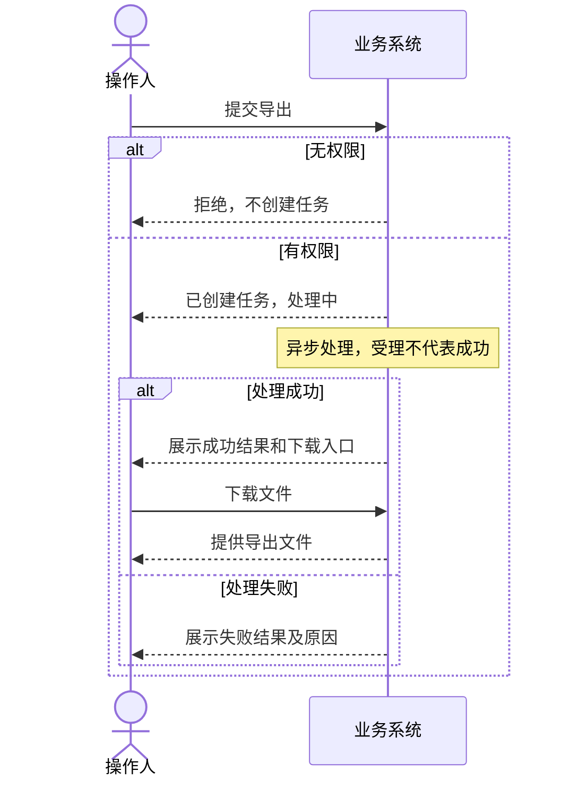
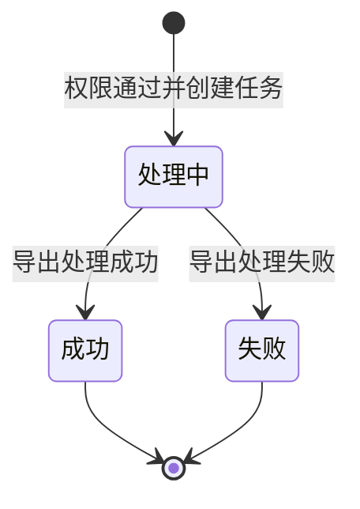

# 业务图示：选型、绘制与验收

图用于评审业务逻辑，不能只展示几个概念及其大致关系。业务事实来自输入 PRD；资料不足处标记「待 PRD 明确」，不得自行添加默认规则。以下示例是假定已确认的独立场景，不是通用业务规则。

## 图种与使用条件

| 图种 | 何时必须提供 | 必须表达 |
|---|---|---|
| 业务流程图 F-xx | 有业务操作流程 | 触发入口、动作归属、系统判断、条件边、成功/拒绝等结果、已定义的返回路径 |
| 泳道/分组流程图 | 上述流程涉及多个角色或责任方 | 动作放入所属泳道，跨角色交接及失败去向清楚；不能仅靠颜色猜责任 |
| 关键时序图 T-xx | 多角色协作、跨端、外部系统或异步任务 | 真实参与方、从上到下的先后、发起与反馈、同步受理与最终完成、影响结果的条件分组 |
| 状态图 S-xx | 对象状态决定可执行动作或页面表现 | 单一对象的初始/终止状态、转换条件、可恢复路径；不混入不同对象的状态 |

时序图按关键场景绘制，不为每个点击画一张；状态图只覆盖业务对象状态，不把页面名当状态。纯静态调整不凑图。其他图种仅在 PRD 明确的对象关系等信息需要评审时补充，不推演技术架构。

## 已有流程图时沿用原图

先检查 PRD 中的 Mermaid、内嵌图片、SVG 或本地引用图，识别各业务场景的现有流程图。对已有图的场景，直接复用原图源或按原图转绘为自包含图示；保留节点文字、参与方、判断条件、连线方向、分支去向和先后顺序，不自行增删、合并或拆分节点和场景，也不另画一套流程。可以调整颜色、字号、间距或添加页面跳转，但不能改变业务语义和结构。

对照正文核实原图：图文冲突、图不完整影响流程判断，或引用图缺失、模糊无法读取时，标明具体问题并请用户确认，不自行决定以哪一方为准。只对 PRD 没有现成流程图的场景，从正文提取已明确的规则绘图。适用的时序图和状态图仍按各自规则提供，不能替代或改写原业务流程图。

## Mermaid 转换与源图核对

将 PRD 的 Mermaid 原文逐张渲染，不自行转写为另一份 Mermaid。执行：

```bash
node "$SKILL_DIR/scripts/render-prd-mermaid.mjs" --prd /absolute/path/PRD.md --out /absolute/path/diagrams
```

脚本统一读取 `assets/diagram-theme.json`，流程、时序和状态使用同一配色，不采用 Mermaid 默认紫色主题。先在 Skill 目录执行 `npm ci --ignore-scripts` 安装锁定的 Mermaid 与 playwright-core，再运行 `scripts/check-env.mjs`。脚本使用公开 Mermaid 的浏览器 ESM 模块；可用 `--mermaid-module` 指定兼容模块路径、`--playwright` 指定 playwright-core，默认不探测其他应用内部文件。Chrome/Chromium 与验收脚本使用同一发现逻辑，支持 `CHROME_PATH`。缺依赖或渲染失败时明确报告并采用可核验的忠实转绘，不能省图或改成文字。转换输出的每张 SVG 含源图序号和 SHA-256，用 `validate-review.mjs 原型.html --prd PRD.md` 检查是否逐图对应；指纹不能证明 SVG 内容真实或布局正确，仍必须人工逐条对照、浏览器目检、导出重开。非 Mermaid 原图仍按原图类型逐项对照验收。

`ReviewComponents.flow` 默认按节点底部到顶部连线，不提供自动避障；横向分支、汇合或回路应显式提供路径与标签坐标，检查箭头实际起止和遮挡。已有 PRD 图优先转换，不用该组件重建。

## 绘图前先核逻辑

从 PRD 提取触发事件、参与方、前置条件、判断、变化和结果，核对以下问题：

- 不同触发入口是否被错误串成时间链？配置保存、推送发生、用户进入应按实际规则连接。
- 每个判断是否有可理解的条件边和去向？复合条件若导致不同结果，必须拆开表达。
- 拒绝、失败、取消、无资格、已处理等分支是否保留各自的业务结果？返回或重试只画已定义的路径。
- 多角色间谁发起、谁决策、谁执行？异步受理是否被错误当成完成？通知失败是否影响业务结果，以 PRD 为准。
- 同一对象名称、状态与正文/页面一致吗？跨图是否把一个事件画成不同顺序或不同结果？

内部映射须能定位每条影响流程走向、交互顺序或状态的规则。关键缺口会改变主链时先澄清，不能用一条箭头掩盖；局部缺口在图旁明确标记，不画成确定分支。

## 绘制与交付

- PRD 有 Mermaid 源码时优先直接渲染；其他现有图优先复用或按原图转绘。没有现成流程图时可用 Mermaid 建模或直接绘制 SVG。可渲染的图转为**内联 SVG**；原图是位图时可嵌入原图数据或忠实转绘，保留原图语义和结构。最终 HTML 双击即可看图，不依赖 CDN、网络请求或外部 Mermaid 运行时；不要仅放 Mermaid 源码。
- 流程图用动作矩形、判断菱形及带标签的条件箭头；泳道标责任方。时序图用参与方、生命线、消息箭头和条件/并行区域，不能用横排方框冒充时序图；并行只在 PRD 明确时使用。
- 不设“主链最多 5 个节点”等会删逻辑的限制。没有现成图且流程过长时，可按业务阶段或场景拆图，给出同名衔接点及图编号；已有图保持原图结构。不要通过缩小字体把所有内容塞进一行。
- **尺寸按图本身确定，不随卡片宽度放大**：内联 SVG 除 `viewBox` 外，写明数值 `width`（默认取 viewBox 宽度），移除 Mermaid 的 `width="100%"` 和冲突的内联宽度样式；保持等比。不得额外乘放大系数，也不设统一最小图宽。短图留白，不拉伸铺满原型宽卡片。
- 浏览器 100% 缩放下，节点文字以接近正文的 14～16px 为起点检查。图过大先收紧节点内边距、间距与不必要换行；无现成图时，图过长可按阶段拆图并保留分支与衔接；已有图保持原结构并允许滚动。超宽图沿容器横向滚动，不为适配宽度将文字缩至难读；项目微调比例不固化为所有图的默认比例。
- 每图使用唯一 id；SVG 的 marker、clipPath 等 id 也须全文件唯一。保留 `viewBox`，预留标签与箭头空间；沿用 `.flow-overview` 的横向滚动，不裁切图示。
- 图表区在设备外壳之外，桌面与移动端原型均适用；每张图有标题、目录入口。实际页面节点可跳转到对应 section，判断和系统节点保持只读。

## 同一业务的三种表达（示例）

假定规则：操作人提交导出；无权限不建任务；有权限创建处理中任务；异步成功后可下载，失败展示原因。示例未定义重试、通知、超时或并发策略，因此不补画。

### F-01 创建与查看导出结果



### T-01 受理与最终结果



消息表达用户可见交互，不暗示使用推送、轮询或其他具体传输实现。

### S-01 单个导出任务



无权限时没有任务，不应出现在任务状态机中；下载是成功后的动作，不是新状态。

## 交付门禁

1. **语义**：已有流程图时逐项对照原图，检查节点及文字、参与方、连线、条件、分支去向和顺序；图文有冲突或缺漏须先确认，不静默改图。无现成图时，对照 PRD 与内部映射逐项检查关键分支、消息顺序和状态转换；正文中已明确的适用规则须体现。不能把条件合并成无解释的“资格判断”。
2. **图形**：若使用 Mermaid，实际解析/渲染成功；若手绘 SVG，检查箭头归属、判断标签和时序区域，而非仅统计节点数。
3. **浏览器**：逐张检查整图及复杂分支，文字可读、节点不过度放大、短图未被宽卡片拉伸、箭头不穿字、连线有明确起止、无裁切，长图滚动可达；逐个检查可跳转页面节点。
4. **导出**：打开导出的自包含 HTML，图示、分支标签、SVG 箭头及页面锚点完整可用。文案编辑门禁不能代替本项验收。

记录实际检查范围；未完成渲染、浏览器或导出检查时，不宣称图示验收通过。
